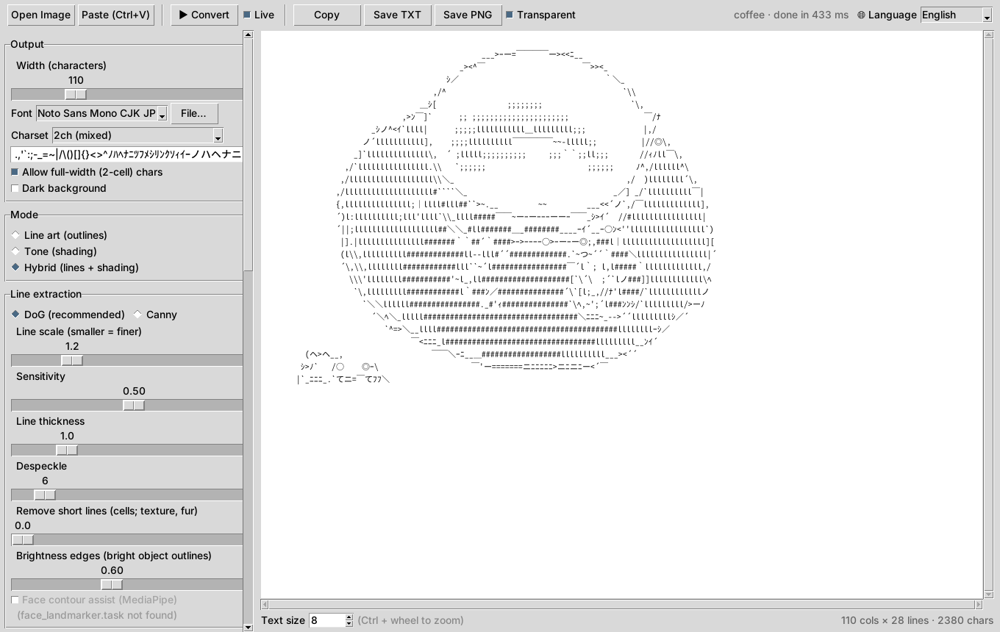

# ASCII Art Maker

[한국어](README.md) | **English** | [日本語](README.ja.md)

A desktop app that turns images into 2ch-style ASCII art (AA).
Built with Python + OpenCV + Tkinter. The UI is available in Korean, English and Japanese.



## Features

- **Three modes**
  - Line art: draws only the outlines with characters
  - Tone: picks characters by brightness alone (keeps shapes readable at small sizes)
  - Hybrid: lines where there are lines, shading characters everywhere else
- **Matching with the real display font**: compares the glyphs exactly as they appear on screen and respects the character aspect ratio
- **Full-width / half-width alignment**: mixing 2-cell characters (ノ, ○, …) never breaks line alignment
- **Line-direction aware**: tells similar characters such as ╱ ╲ ─ │ apart by stroke angle
- **Subject isolation**: removes the background automatically and draws only the subject, larger (characters, objects, full-body shots)
- **Shading control**: shading contrast, number of shading levels, choice of character sets
- **Face contour assist** (optional): uses MediaPipe to keep faces clear even at small sizes
- Live preview, clipboard paste, save as TXT, **save as PNG with a transparent background**

## Install

Requires Python 3.10 or later.

```
pip install -r requirements.txt
```

For the face contour assist:

```
pip install mediapipe
```

Then download the [MediaPipe face landmarker model](https://storage.googleapis.com/mediapipe-models/face_landmarker/face_landmarker/float16/1/face_landmarker.task)
and put it next to the program as `face_landmarker.task`. Without it, only this feature is disabled.

## Run

```
python askill_art_maker.py
```

Change the language from the top-right corner; your choice is remembered next time.

## Tips

- On Windows the default font is **MS Gothic**, the font 2ch ASCII art was originally made for.
- For photos, start in **Line art** mode and adjust only *Sensitivity* and *Line scale*.
- For characters or objects on a simple background, turn on **Isolate subject**.
- For stronger shading, raise **Shading contrast** and lower **Shading levels** to about 3.
