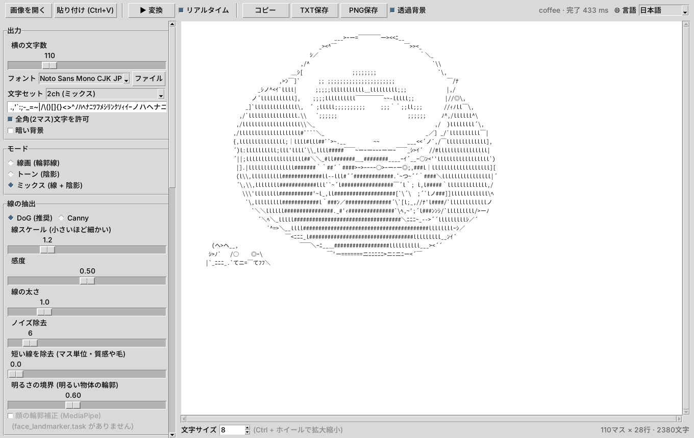

# アスキーアートメーカー

[한국어](README.md) | [English](README.en.md) | **日本語**

画像を2ch風アスキーアート(AA)に変換するデスクトップアプリです。
Python + OpenCV + Tkinter製で、画面は韓国語・英語・日本語に対応しています。



## 主な機能

- **3つのモード**
  - 線画: 輪郭線だけを文字で描く
  - トーン: 明るさだけで文字を選んで塗る (小さいサイズでも形が分かりやすい)
  - ミックス: 線は線で描き、それ以外は陰影文字で埋める
- **実際の表示フォントでマッチング**: 画面に表示される字形そのもので比較し、文字の縦横比も反映
- **全角・半角の混在でも行がずれない**: 2マス文字(ノ、○など)を混ぜても揃う
- **線の向きを認識**: ╱ ╲ ─ │ のような似た文字を線の角度で区別
- **被写体分離**: 背景を自動で消して被写体だけを大きく描く (キャラクター・物体・全身用)
- **陰影の調整**: 陰影コントラスト、段階数、文字セットの選択
- **顔の輪郭補正** (任意): MediaPipeで顔の輪郭を捉え、小さいサイズでも顔をはっきり表示
- リアルタイムプレビュー、クリップボード貼り付け、TXT保存、**透過背景PNG保存**

## インストール

Python 3.10以上が必要です。

```
pip install -r requirements.txt
```

顔の輪郭補正を使う場合:

```
pip install mediapipe
```

さらに[MediaPipe 顔ランドマークモデル](https://storage.googleapis.com/mediapipe-models/face_landmarker/face_landmarker/float16/1/face_landmarker.task)をダウンロードし、
`face_landmarker.task` という名前でプログラムと同じフォルダに置いてください。無い場合はこの機能だけが無効になります。

## 実行

```
python askill_art_maker.py
```

画面右上で言語を切り替えられます。選んだ言語は次回の起動時にも保持されます。

## 使い方のコツ

- Windowsでは **MS ゴシック (MS Gothic)** が既定のフォントです。2ch AAが本来使うフォントなので最も自然に表示されます。
- 写真なら、まず **線画モード** で「感度」と「線スケール」だけを調整してみてください。
- 背景が単純なキャラクターや物体は **被写体分離** をオンにするとはっきりします。
- 陰影を強くしたいときは **陰影コントラスト** を上げ、**陰影の段階数** を3くらいに下げてください。
