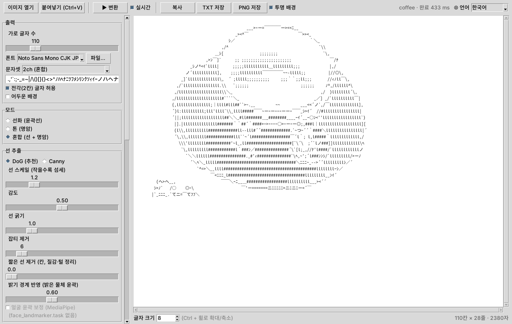

# 아스키 아트 메이커

**한국어** | [English](README.en.md) | [日本語](README.ja.md)

이미지를 2ch 스타일 아스키 아트(AA)로 바꿔주는 데스크톱 프로그램입니다.
Python + OpenCV + Tkinter로 만들었고, 화면은 한국어·영어·일본어를 지원합니다.



## 주요 기능

- **3가지 모드**
  - 선화: 윤곽선만 글자로 그림
  - 톤: 밝기만으로 글자를 골라 채움 (작은 크기에서 형태가 가장 잘 보임)
  - 혼합: 선은 선대로, 빈 칸은 명암 문자로 채움
- **실제 표시 폰트 기준 매칭**: 화면에 보이는 글자 모양 그대로 비교하고, 글자 세로 비율도 반영
- **전각/반각 혼용 줄 맞춤**: 2칸 글자(ノ, ○ 등)를 섞어도 줄이 틀어지지 않음
- **선 방향 인식**: ╱ ╲ ─ │ 처럼 비슷한 글자를 선 각도로 구분
- **피사체 분리**: 배경을 자동으로 지우고 피사체만 크게 그림 (캐릭터·물체·전신용)
- **명암 조절**: 명암 대비, 명암 단계 수, 문자 세트 선택
- **얼굴 윤곽 보정** (선택): MediaPipe로 얼굴 윤곽을 잡아 작은 크기에서도 얼굴이 또렷하게
- 실시간 미리보기, 클립보드 붙여넣기, TXT 저장, **투명 배경 PNG 저장**

## 설치

Python 3.10 이상이 필요합니다.

```
pip install -r requirements.txt
```

얼굴 윤곽 보정까지 쓰려면:

```
pip install mediapipe
```

그리고 [MediaPipe 얼굴 랜드마크 모델](https://storage.googleapis.com/mediapipe-models/face_landmarker/face_landmarker/float16/1/face_landmarker.task)을 받아서
`face_landmarker.task`라는 이름으로 프로그램과 같은 폴더에 넣으세요. 없으면 이 기능만 꺼지고 나머지는 정상 동작합니다.

## 실행

```
python askill_art_maker.py
```

화면 오른쪽 위에서 언어를 바꿀 수 있고, 선택한 언어는 다음 실행 때도 유지됩니다.

## 사용 팁

- 윈도우에서는 **MS Gothic** 폰트가 기본입니다. 2ch 아스키 아트가 원래 쓰는 폰트라 가장 자연스럽습니다.
- 사진이면 먼저 **선화 모드**에서 '감도'와 '선 스케일'만 조절해 보세요.
- 배경이 단순한 캐릭터·물체는 **피사체 분리**를 켜면 훨씬 또렷해집니다.
- 명암을 세게 하려면 **명암 대비**를 올리고 **명암 단계 수**를 3 정도로 낮추세요.
